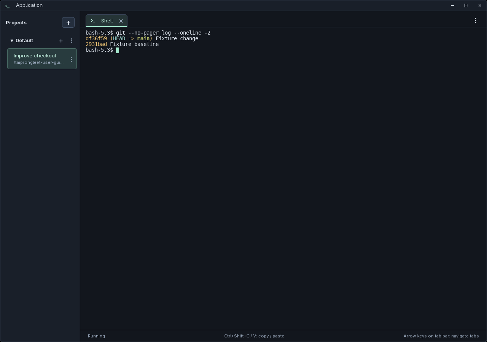
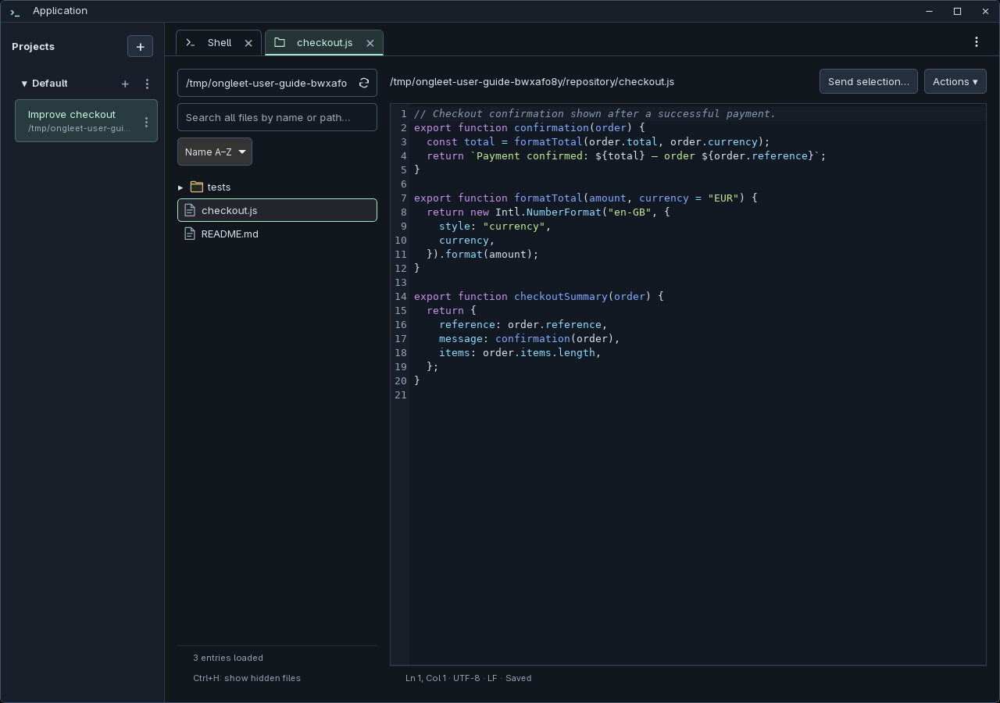
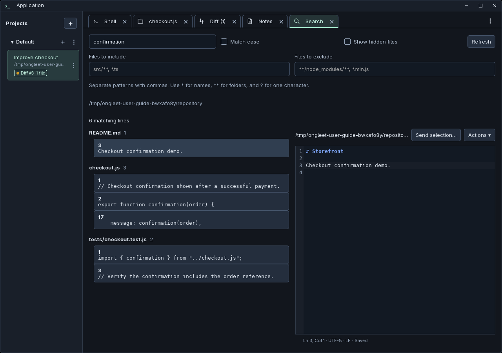
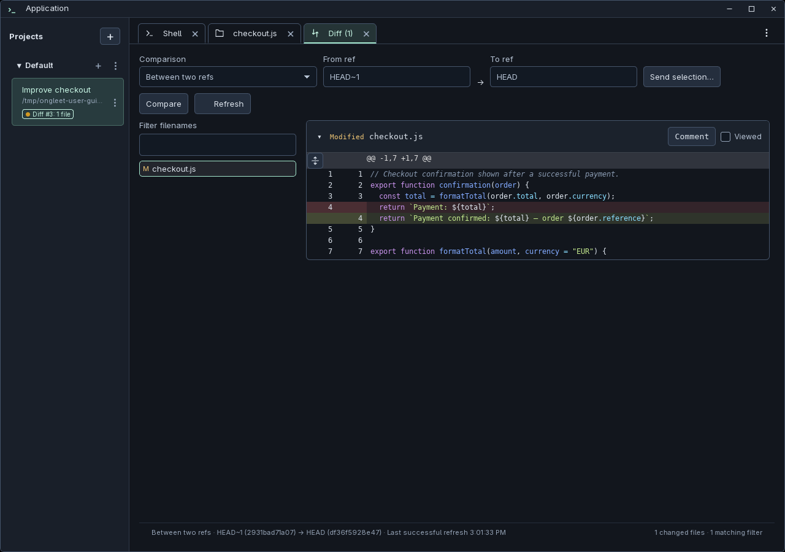
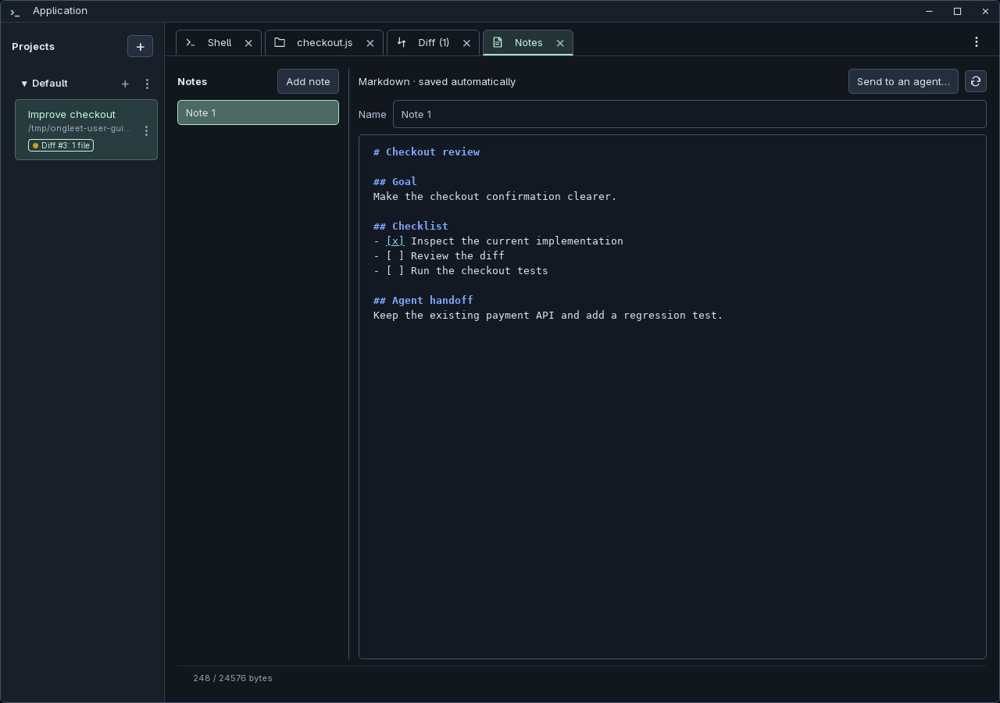
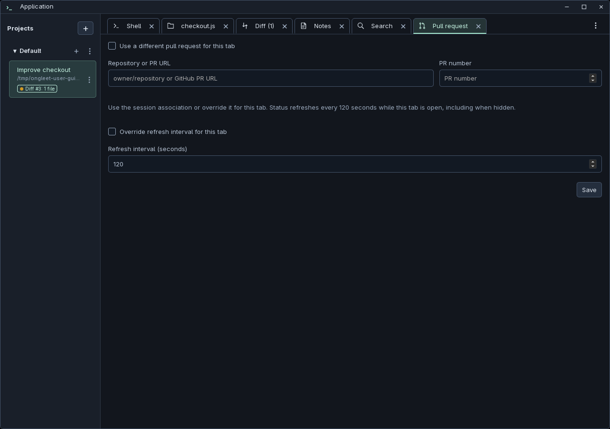
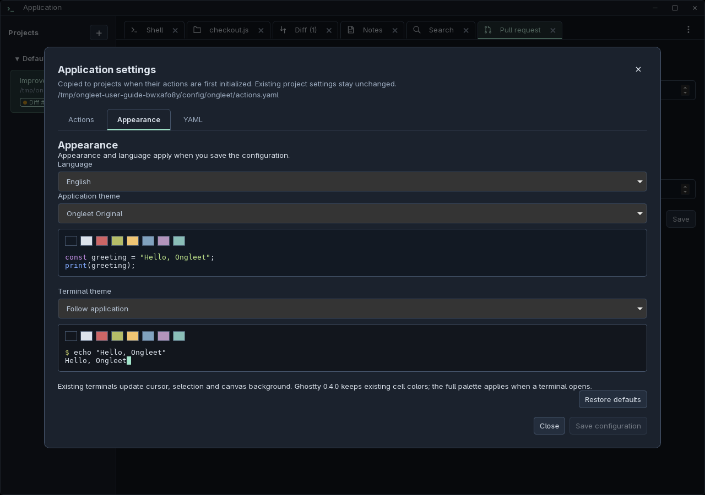

# Ongleet user guide

Ongleet brings terminals, files, search, code review and notes into one desktop
workspace. Use it to keep everything for a development task together, whether you
work directly, with a terminal agent, or through the Ongleet CLI.

This guide uses the English interface. To switch to French, open **Application →
Configure… → Appearance → Language**, choose French and save.

## Contents

- [Your first workspace](#your-first-workspace)
- [Projects, sessions and tabs](#projects-sessions-and-tabs)
- [Terminals and agents](#terminals-and-agents)
- [Browse and edit files](#browse-and-edit-files)
- [Search file contents](#search-file-contents)
- [Review changes with Diff](#review-changes-with-diff)
- [Keep session notes](#keep-session-notes)
- [Follow a pull request](#follow-a-pull-request)
- [Customize your workspace](#customize-your-workspace)
- [Archive, restore and quit](#archive-restore-and-quit)
- [Common questions](#common-questions)

## Your first workspace

Install and launch Ongleet using the [installation instructions](../README.md#get-started).
The current Linux preview requires a graphical desktop and the host capabilities
listed there. Separate guides cover [Windows](WINDOWS.md) and [macOS](MACOS.md),
including their validation limitations.

1. Open **Application → New project…**. Give the project a name and select an
   existing directory. A project groups related sessions and defines reusable actions.
2. Create a session with the sidebar's **Create session** button. Give it a task
   name, such as “Improve checkout”, and choose its existing working directory.
3. Save the session. Its first configured terminal action starts automatically.
4. Open the **⋮** menu at the end of the tab bar to add tools. Choose a configured
   action, or **Custom tab…** to select a plugin and its settings.
5. Add Files, Diff and Note tabs to inspect code, review changes and record decisions.

Ongleet uses the directories you provide. Creating a project or session does not
create a directory, clone a repository or create a Git worktree.

## Projects, sessions and tabs

| Item    | Use it for                                          | Example                   |
| ------- | --------------------------------------------------- | ------------------------- |
| Project | A repository or area of work, with reusable actions | Storefront                |
| Session | One task and its working directory                  | Improve checkout          |
| Tab     | One tool within that task                           | Shell, Files, Diff, Notes |

The left sidebar groups sessions by project. Select a session to return to its
tabs. Switching away keeps running terminals alive, including their output.
Fold projects to reduce clutter. Drag session grips and tabs to reorder them;
with a session grip focused, **Alt+Up/Down** changes its position.

Session tags summarize activity, diff review progress and linked pull request
status. A terminal or PR tab can update its own tags as its state changes.

Changing a session directory affects future launches. A shell that is already
running stays in its current directory; use `cd` there or launch another terminal.

## Terminals and agents



Run your usual shell commands and terminal tools. Agents such as Codex run inside
terminal tabs; install those tools separately. Name tabs by role, such as “Agent”,
“Tests” and “Server”, so you can find the right process quickly.

Project actions let you save a command and its configuration for reuse. Edit a
project's actions to add your preferred shells or tools. **Custom tab…** is useful
for a one-off configuration. Changes to a running terminal's saved configuration
apply to its next launch.

| Gesture           | Result                                                   |
| ----------------- | -------------------------------------------------------- |
| Drag across text  | Select and copy terminal text                            |
| Ctrl+Shift+C      | Copy the current selection                               |
| Ctrl+Shift+V      | Paste clipboard text or quoted file paths                |
| Shift+drag        | Select text when a terminal program captures mouse input |
| Ctrl+click a link | Open the link in the associated application              |

Pasted text is terminal input: newlines can execute commands. Image attachment
handling belongs to the terminal application; see [clipboard details](USAGE.md#terminal-mouse-clipboard-and-links).

To discuss code with an agent, select text in Files, Diff or Note and use its
send-to-agent action. Choose the destination terminal and add your question.
Ongleet includes the relevant context; Files can send the current unsaved buffer.
Check the destination and message before sending.

The CLI controls the same workspace. In an Ongleet terminal, try:

```bash
ongleet tab actions --json
ongleet tab list --json
```

Use the returned action IDs to create tabs and tab IDs to inspect capabilities.
See the [CLI reference](USAGE.md#cli) for configuration and automation examples.

## Browse and edit files



Open a **Files** tab for the session directory, then select a file in the tree.
Expand folders as needed and resize the divider to give the tree or editor more
room. Filename search helps locate paths; use Search for text inside files.

Edit text in the main pane and save explicitly to update the file on disk. Local
recoverable drafts protect unsaved work across reloads and restarts. The detail
bar indicates unsaved changes and draft storage. A draft is not a saved file or a
backup of your repository.

If another tool changes a clean file, Files refreshes it. If you have unsaved
changes, Ongleet offers conflict handling instead of silently replacing them.
Read the conflicting versions before choosing a merge or forced save. Reloading
or closing a file may ask you to discard edits.

Supported images open in a preview with zoom and reload controls. Other unsupported
formats show file details and an explicit option to open an external application.
File deletion requires confirmation; review the selected path carefully.

Hidden-file visibility and sort order can be shared through **⋮ → Shared session
settings → Files**. Choose **All projects** or **This session**. Use **Tab →
Configure…** in the same menu for a tab-specific override. **Ctrl+H** toggles hidden
files in the browser.

## Search file contents



Open **Search**, enter text in **Search file contents**, and inspect the matching
lines grouped by file. Select a result to open the shared editor beside the results
and work on the matching file without losing the result list.

Use the include and exclude fields to narrow the search. For example, include
`src/**` or `*.ts`, and exclude `**/node_modules/**` or `*.min.js`. Search defaults
to the session directory; configure the tab to use another folder.

Search scans UTF-8 text with bounded results and file sizes. A limit or skipped
file message means the results may be incomplete. Narrow the folder or filters
when looking through a large repository. Refresh the search after edits when you
need a new set of matches.

## Review changes with Diff



Open **Diff** in a session whose directory belongs to a Git repository. Choose the
comparison in the toolbar: local work, branch comparison, commits, or a commit
against the working tree. Check the selected references before starting a review;
a branch comparison can include local changes.

1. Select a file in the left tree to jump to its changes.
2. Read additions and deletions in the continuous diff. Expand context when you
   need more surrounding lines.
3. Mark reviewed files as viewed. Progress appears in the tab and session tags.
4. Add a discussion at a relevant line, or select code to send a question to an agent.
5. Use the tree's discussion entries to return to comments. Refresh after further
   edits; changed files may need review again.

Large diffs can show a placeholder explaining the display limit and offering
explicit loading. Binary or unsupported content cannot be reviewed as a normal
text patch. Local discussions are Ongleet data; sending one to a terminal does
not publish a GitHub review.

## Keep session notes



Open **Note** to keep a task checklist, investigation notes or an agent handoff.
Use **Add note** to create another entry, select it in the left sidebar and edit
its Name field to rename it.

Notes use a Markdown editor with syntax highlighting and save automatically.
They belong to the Note tab and persist locally through restart and session
archive/restore. They are not Markdown files in your repository. Copy important
material into a tracked file when it needs to travel with the code.

Select text to send it with context to an agent terminal. Agents can also read
and update notes through revision-checked CLI actions; see
[Note interactions](PLUGINS.md#note).

## Follow a pull request



Open **Pull request** and explicitly associate a GitHub PR with the session.
Ongleet does not infer a PR from the current branch. Configure the association
and any tab overrides in **⋮ → Tab → Configure…**.

Set up a GitHub account through **⋮ → Shared session settings → Pull request**.
Use **All projects** for the shared account or **This session** for a separate
account. Saved tokens use the native credential store. A global account can also
use `GH_TOKEN` or `GITHUB_TOKEN` from the application's launch environment.

Once connected, the tab shows PR state, submitted reviews, linked closing issues
and checks for the latest commit. Open the PR in your browser for GitHub actions.
Ongleet's integration reads status; it does not merge PRs or submit reviews.

The default refresh interval is 120 seconds, including while the tab or session
is hidden. Refresh manually when needed. Sidebar tags surface PR state, failed
checks and new reviews; **Mark reviews read** acknowledges new reviews locally.
The first successful fetch establishes the review baseline.

If a refresh fails, check the displayed error and last successful refresh time.
The previous snapshot may remain visible. See [GitHub authentication and
permissions](USAGE.md#built-in-tab-plugins) for token requirements and account behavior.

## Customize your workspace



Open **Application → Configure… → Appearance** to choose the interface language
and one of six appearance presets. Save the configuration to apply it. An optional
terminal preset lets new terminals use a different palette.

Existing terminal cells retain their launch colors; open a new terminal for the
full new palette. See [appearance details](APPEARANCE.md).

Global actions provide reusable defaults, while project actions adapt them to a
repository. Use the configuration forms first; the [YAML reference](USAGE.md#projects-and-actions-yaml)
describes advanced command and environment configuration.

## Archive, restore and quit

Archive a finished session through its menu. The tab close cross archives a tab's
definition; confirm any warning about running processes or unsaved edits.
Archiving stops the affected terminals but leaves project files untouched.

Open **⋮ → Session → Archives** to restore archived sessions or tabs. Restore a
parent session before its separately archived tabs. Archives expire after
**30 days**; permanent deletion removes Ongleet's archived data, not the project's
working directory. Restoring a terminal starts a new process when eligible.

The window close button and **Application → Quit** confirm, save state, stop
managed terminal processes and exit. At the next launch, Ongleet restores the
workspace metadata. Eligible commands may restart as new processes; saved text
history does not restore a running shell or an agent's in-memory state.

## Common questions

| Problem                                       | What to check                                                                                                 |
| --------------------------------------------- | ------------------------------------------------------------------------------------------------------------- |
| A new terminal cannot start                   | Verify its executable and working directory. On Linux, run the documented host check for containment support. |
| A session still uses its old directory        | Directory changes apply to future launches. Change directory in the running shell or open a new terminal.     |
| A tool is missing from the tab menu           | Use Custom tab, or add the plugin to the project's actions. Existing projects keep their saved action lists.  |
| A file has external changes                   | Use the conflict flow; inspect the other version before forcing a save.                                       |
| A search misses a file                        | Check folder, include/exclude filters, UTF-8 support and reported limits.                                     |
| PR status looks outdated                      | Check the refresh time, connection, token permissions and any rate-limit error.                               |
| Terminal colors did not fully change          | Existing cells keep their launch palette. Open a new terminal.                                                |
| A development window cannot load its terminal | Restart the documented development command so Vite and the native app are both available.                     |

For detailed configuration, recovery behavior and diagnostics, continue with the
[usage reference](USAGE.md). For installation and platform status, return to the
[README](../README.md).

Screenshots show the native Linux application with an isolated demonstration
workspace. Paths, task names and file contents are examples. The PR screenshot
shows setup, not live GitHub data. See [capture instructions](images/README.md) for
reproducing the illustrations.
